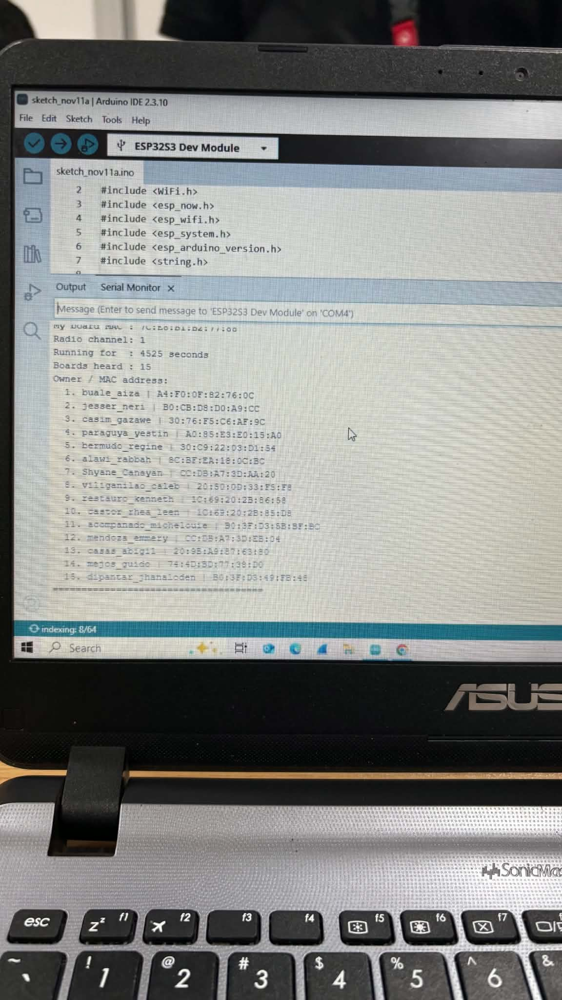

# My ESP-NOW Results

## Personal Information

| Item | Details |
|---|---|
| Name | cadiz_michael |
| My Board's MAC Address | 7C:E8:B1:B2:77:88 |
| Number of Boards Heard | 15 |
| Radio Channel | 1 |
| Date of Block Window | November 11, 2026 |
| Block Window Time | [2pm- 5pm] |
| Result Timestamp | 4525 seconds runtime (PHT, UTC+8) |

## Boards My ESP32 Heard

My ESP32 successfully detected 15 other ESP32 boards through ESP-NOW.

| No. | Owner Name | MAC Address |
|---:|---|---|
| 1 | buale_aiza | A4:F0:0F:82:76:0C |
| 2 | jesser_neri | B0:CB:D8:D0:A9:CC |
| 3 | casim_gazawe | 30:76:F5:C6:AF:9C |
| 4 | paraguya_yestin | A0:85:E3:E0:15:A0 |
| 5 | bermudo_regine | 30:C9:22:03:D1:54 |
| 6 | alawi_rabbah | 8C:BF:EA:18:0C:BC |
| 7 | Shyane_Canayan | CC:DB:A7:3D:AA:20 |
| 8 | viliganilao_caleb | 20:50:0D:33:F5:F8 |
| 9 | restauro_kenneth | 1C:69:20:2B:86:58 |
| 10 | castor_rhea_leen | 1C:69:20:2B:85:D8 |
| 11 | acompanado_michelouie | B0:3F:D3:5B:BF:BC |
| 12 | mendoza_emmery | CC:DB:A7:3D:EB:04 |
| 13 | casas_abigil | 20:9B:A9:87:63:80 |
| 14 | mejos_guido | 74:4D:BD:77:38:D0 |
| 15 | dipantar_jhanaloden | B0:3F:D3:49:FB:48 |

## Serial Monitor Screenshot

## 30-Second Serial Monitor Video

[cadiz_SerialMonitor.mp4](cadiz_SerialMonitor.mp4)
